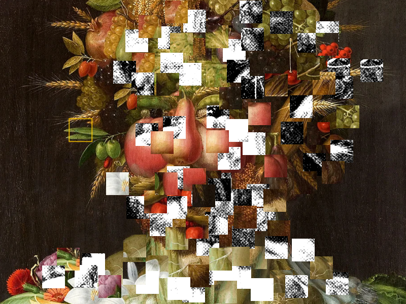

# E1. Ricombinare una fotografia

Lavoro pubblicato: https://fran-soriano.github.io/aa2627-tnmi-es/es1/

`preview.png` va creata quando il lavoro è pronto: serve all'anteprima nella
pagina delle revisioni del corso.
